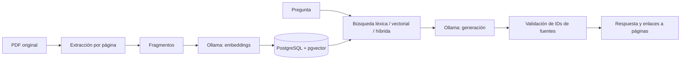

# Cuaderno · Asistente de estudio verificable

[](https://github.com/liamanderson873/asistente-estudio-RAG/actions/workflows/tests.yml)

Proyecto de portfolio centrado en **IA aplicada, datos y bases de datos**. Carga PDFs con texto, recupera fragmentos mediante búsqueda léxica/vectorial/híbrida y genera respuestas en español con enlaces al documento y su página física.

Los documentos de muestra son materiales originales sobre SQL y Python. No se utilizan apuntes universitarios ni información personal real.

## Primera versión

- Extracción por página, incluso cuando el PDF contiene páginas en blanco.
- Fragmentos con solapamiento que no cruzan páginas.
- PostgreSQL con documentos originales, páginas, fragmentos y embeddings de 768 dimensiones.
- Cargas idempotentes por SHA-256; restricción única y bloqueo transaccional contra duplicados concurrentes.
- Búsqueda de texto en español, similitud coseno exacta con pgvector y fusión de rankings RRF.
- Ollama local para embeddings y generación, detrás de un adaptador HTTP.
- Respuesta estructurada: si faltan fuentes o las referencias son inválidas, se muestra una abstención.
- Web pequeña en español para cargar PDFs, preguntar y consultar las fuentes.
- Evaluación de recuperación y pruebas unitarias/de integración.

**Estado:** implementación inicial. Consulta [las verificaciones realizadas](docs/verification.md) antes de asumir que los servicios o modelos se han probado en este equipo. El proyecto deportivo es independiente y no se modifica.

**En este ordenador:** se ha preparado un [entorno con Ollama nativo y PostgreSQL en Docker Desktop](docs/local-environment.md). No arrancar a la vez ese entorno y todos los servicios de Compose, porque comparten puertos.

## Arranque con Docker Desktop

Necesitas Docker Desktop activo, contenedores Linux, conexión para la primera descarga y varios GB libres para imágenes y modelos.

Desde esta carpeta:

```powershell
docker compose up --build -d
docker compose logs -f models app
```

La primera ejecución descarga `embeddinggemma` y `qwen2.5:3b`; puede tardar. La aplicación arranca cuando las descargas terminan y la base de datos está lista. Después abre **http://localhost:8011** y sube los dos PDFs de `demo/`. La generación se ejecuta en CPU; su velocidad debe medirse en el equipo real.

Puertos exclusivos: aplicación **8011**, PostgreSQL **55433**, Ollama **11435**, todos enlazados a localhost. Volúmenes `study-rag_study_data` y `study-rag_study_models`. El Compose no necesita ni reutiliza el contenedor del dashboard.

Para detener conservando datos y modelos: `docker compose down`. El SQL inicial se aplica solamente al crear el volumen de PostgreSQL; futuros cambios del esquema necesitarán migraciones.

Las imágenes `pg17` y `latest` son etiquetas móviles. `uv.lock` fija las dependencias de Python; fijar digests de imágenes y versiones de modelos es trabajo pendiente para una entrega completamente reproducible.

## Desarrollo en Windows

Con Python 3.13 y uv:

```powershell
uv sync --frozen
Copy-Item .env.example .env
docker compose up -d db ollama models
uv run uvicorn study_rag.app:app --host 127.0.0.1 --port 8011
```

La interfaz abre aunque los servicios no estén disponibles; en ese caso indica el error y no inventa una biblioteca ni respuestas. `/health` solo comprueba el proceso de la API, no la disponibilidad de PostgreSQL ni Ollama. API interactiva: `/docs`.

Puedes cambiar el generador mediante `CHAT_MODEL`; descarga primero el modelo correspondiente o repite el servicio `models`. Cambiar `EMBEDDING_MODEL` requiere otro modelo de **768 dimensiones** y volver a cargar los PDFs: las búsquedas filtran por el modelo configurado y no mezclan sus espacios vectoriales. Cambiar las dimensiones requiere modificar el esquema y migrar los datos. Para otro proveedor de IA, implementar el protocolo `Model` y cambiar su construcción en `create_app`.

## Pruebas y calidad

```powershell
uv run ruff check .
uv run pytest -q
docker compose config --quiet
```

Sin `TEST_DATABASE_URL`, las pruebas de PostgreSQL se omiten con una explicación. Para ejecutarlas usa una base dedicada cuyo nombre termine en `_test`; cada prueba crea y elimina su propio esquema. El workflow de GitHub ejecuta las pruebas con PostgreSQL real y pgvector en cada push y pull request.

Las pruebas con dobles validan lógica y errores controlados. No prueban la calidad del modelo, la velocidad del equipo ni las consultas reales de PostgreSQL.

## Corpus original y evaluación

Los PDFs se regeneran con `uv run python scripts/generate_demo.py`, a partir de `demo/source.json`. Licencia del material: [CC BY 4.0](demo/LICENSE.md). La numeración usada por las citas es la página física del PDF empezando en 1.

Con los dos documentos cargados y el servidor activo:

```powershell
uv run python scripts/evaluate.py --split dev --output evaluation/results-dev.json
```

El programa compara búsqueda léxica, vectorial e híbrida con **recall@5 por página** y **MRR**. Varias coincidencias en la misma página no cuentan como fuentes distintas. El corpus es pequeño y está relacionado con las preguntas: sus métricas sirven como prueba inicial, no como evidencia de rendimiento general.

Se reservan preguntas `holdout` para la comprobación final; no usarlas para ajustar parámetros. Las preguntas sin respuesta se excluyen de las métricas de recuperación y deben revisarse con `/api/ask` comprobando que el asistente se abstiene. Las métricas de recuperación no miden la corrección de la respuesta generada.

## Arquitectura



Código: `src/study_rag/`. SQL: `sql/`. Pruebas: `tests/`. Decisiones: `docs/plans/`. Graphify y Understand Anything son herramientas para comprender el repositorio; no forman parte del motor RAG.

## Límites conocidos y próximos pasos

- Validar un ID de cita **no garantiza** que el texto respalde cada afirmación. Falta evaluación manual de fidelidad y corrección con el modelo real.
- Sin OCR: PDFs escaneados, cifrados o ilegibles se rechazan. Una página escaneada dentro de un PDF mixto puede quedar sin texto.
- La búsqueda vectorial siempre devuelve vecinos si hay fragmentos; no constituye un detector de relevancia por sí sola. La abstención también depende del modelo.
- Sin usuarios ni despliegue público: se guardan los PDFs en PostgreSQL y se sirven en la aplicación local. No introducir documentos sensibles para una demo.
- Faltan límites de concurrencia en la API, procesamiento en segundo plano, migraciones del esquema y reindexación automática ante cambios del pipeline.
- Próximo hito: arrancar servicios reales, medir memoria y tiempos, revisar respuestas/citas y ajustar con el conjunto de desarrollo.
